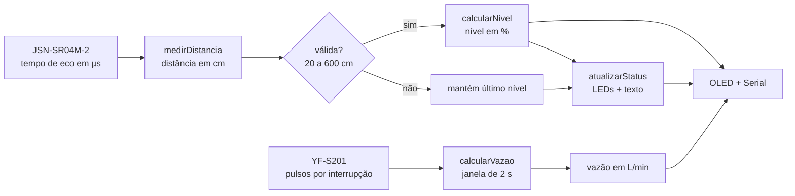

# Análise dos cálculos dos sensores — Sensor de Rios (físico)

Análise do firmware em [`../projeto-fisico-sensor-rios/src/main.cpp`](../projeto-fisico-sensor-rios/src/main.cpp).
Os valores numéricos deste documento foram gerados e conferidos com o script
[`modelo_calibracao.py`](modelo_calibracao.py), que reproduz as mesmas fórmulas do firmware.

Documentos relacionados: ligações na protoboard em
[`../projeto-fisico-sensor-rios/diagrama/conexoes-protoboard.md`](../projeto-fisico-sensor-rios/diagrama/conexoes-protoboard.md),
procedimento de ensaio com volume conhecido em [`../docs/calibracao.md`](../docs/calibracao.md) e planilha de registro em
[`../dados/calibracao/modelo-calibracao.csv`](../dados/calibracao/modelo-calibracao.csv).

## 1. Visão geral do fluxo de dados



A cada volta do `loop()` (~200 ms de `delay` + até 40 ms de espera do eco) o firmware mede a distância,
converte para nível, atualiza LEDs, fecha a janela de vazão (se já passaram 2 s) e redesenha o OLED.

## 2. Parâmetros de calibração

| Constante | Valor | Onde | Significado |
|---|---|---|---|
| `DISTANCIA_VAZIO_CM` | 30,0 cm | `main.cpp` | Distância sensor→água com nível **0 %** |
| `DISTANCIA_CHEIO_CM` | 20,0 cm | `main.cpp` | Distância sensor→água com nível **100 %** |
| `PULSOS_POR_LITRO` | 450,0 | `main.cpp` | Pulsos do YF-S201 por litro |
| `TEMPO_VAZAO` | 2000 ms | `main.cpp` | Janela de contagem de pulsos |
| velocidade do som | 0,0343 cm/µs | `medirDistancia()` (fixo no código) | 343 m/s (≈ 20 °C) |
| faixa válida | 20 a 600 cm | `medirDistancia()` (fixo no código) | Fora disso a leitura é descartada |
| limites de status | 33 % e 66 % | `atualizarStatus()` (fixo no código) | Fronteiras NORMAL / ATENÇÃO / PERIGO |

## 3. Sensor de nível — JSN-SR04M-2

### 3.1 Disparo e leitura do eco

```cpp
digitalWrite(JSN_RX, HIGH); delayMicroseconds(120); digitalWrite(JSN_RX, LOW);   // trigger de 120 µs
unsigned long duracao = pulseIn(JSN_TX, HIGH, 40000);                            // eco, timeout 40 ms
```

* O pino do ESP32 chamado `JSN_RX` (GPIO 2) é a entrada de **trigger** do módulo; `JSN_TX` (GPIO 4) é a saída de **eco**.
* `pulseIn` devolve, em µs, quanto tempo o eco ficou em nível alto. Retorno `0` = nenhum eco no tempo limite
  (40 ms ≈ 686 cm de alcance máximo teórico), e a leitura vira `-1` (inválida).

### 3.2 Tempo → distância

```
distância (cm) = duração (µs) × 0,0343 / 2
```

O som percorre o caminho de **ida e volta**, por isso a divisão por 2. O fator 0,0343 cm/µs equivale a 343 m/s.

| Eco (µs) | Distância |
|---:|---:|
| 1100 | 18,87 cm → **descartada** (< 20 cm) |
| 1167 | 20,01 cm |
| 1458 | 25,00 cm |
| 1749 | 30,00 cm |
| 2000 | 34,30 cm |

Leituras fora de 20–600 cm retornam `-1`. O limite inferior de 20 cm acompanha a zona cega do módulo.

### 3.3 Distância → nível (%)

Interpolação linear entre os dois pontos de calibração, saturada em 0 e 100:

```
nível (%) = (DISTANCIA_VAZIO − distância) / (DISTANCIA_VAZIO − DISTANCIA_CHEIO) × 100
          = (30 − d) / (30 − 20) × 100
          = (30 − d) × 10
```

Quanto **menor** a distância, mais perto da água está o sensor, ou seja, **mais alto** o nível do rio.

| Distância | Nível | Status |
|---:|---:|---|
| ≥ 30,0 cm | 0 % | NORMAL (verde) |
| 28,0 cm | 20 % | NORMAL (verde) |
| 26,7 cm | 33 % | ATENÇÃO (amarelo) |
| 25,0 cm | 50 % | ATENÇÃO (amarelo) |
| 23,4 cm | 66 % | PERIGO (vermelho) |
| 22,0 cm | 80 % | PERIGO (vermelho) |
| 20,0 cm | 100 % | PERIGO (vermelho) |

### 3.4 Nível → status e LEDs

| Condição | LED | `statusNivel` |
|---|---|---|
| nível < 33 % | Verde (GPIO 18) | `NORMAL` |
| 33 % ≤ nível ≤ 66 % | Amarelo (GPIO 19) | `ATENCAO` |
| nível > 66 % | Vermelho (GPIO 21) | `PERIGO` |

Em distância: amarelo a partir de 26,7 cm e vermelho abaixo de 23,4 cm.

### 3.5 Tratamento de leitura inválida

Se `medirDistancia()` retorna `-1`, o firmware **mantém a última distância e o último nível válidos** e imprime
um aviso no Serial. O OLED mostra `Dist: ERRO` apenas quando `distancia < 0`, o que só ocorre antes da primeira
leitura válida (a variável nunca volta a `-1` depois disso).

## 4. Sensor de vazão — YF-S201

### 4.1 Contagem de pulsos

```cpp
attachInterrupt(digitalPinToInterrupt(FLUXO_PIN), contarPulso, RISING);   // GPIO 5
void IRAM_ATTR contarPulso() { pulsos++; }
```

Cada borda de subida do sinal incrementa `pulsos`. Na protoboard, o sinal chega ao GPIO 5 por um resistor de 1 kΩ em
série, com pull-up de 2,2 kΩ ao 3V3 (jumper `I8 → E6`, resistor `E6 → G1`). A cada `TEMPO_VAZAO` (2 s) o valor é copiado e zerado
dentro de uma seção crítica (`noInterrupts()` / `interrupts()`), evitando perder ou contar pulso duas vezes.

### 4.2 Pulsos → vazão

O YF-S201 gera ≈ 7,5 pulsos/s para cada 1 L/min (`F = 7,5 × Q`), o que dá **450 pulsos por litro**.

```
litros na janela = pulsos / 450
vazão (L/min)    = litros na janela × (60 s / 2 s) = (pulsos / 450) × 30
                 = pulsos / 15
```

| Pulsos em 2 s | Vazão |
|---:|---:|
| 0 | 0,000 L/min |
| 1 | 0,067 L/min |
| 15 | 1,000 L/min |
| 75 | 5,000 L/min |
| 150 | 10,000 L/min |
| 450 | 30,000 L/min |

* **Volume por pulso:** 1000 / 450 ≈ 2,22 mL.
* **Resolução:** 1 pulso na janela de 2 s equivale a 0,067 L/min; a vazão é atualizada só a cada 2 s.
* O YF-S201 é especificado para aproximadamente 1 a 30 L/min; abaixo de ~1 L/min a leitura perde confiabilidade.

## 5. Pontos de atenção encontrados na análise

Observações sobre o código atual, para decidir na calibração. Nenhuma foi alterada no firmware.

1. **Resolução baixa do nível.** O intervalo VAZIO→CHEIO é de apenas 10 cm, então **1 cm = 10 %**.
   Módulos JSN-SR04M-2 costumam ter precisão típica da ordem de ±1 cm (confirme no datasheet do seu módulo),
   o que equivale a ±10 % de nível. Um intervalo maior ou a média/mediana de várias leituras reduz o erro.
2. **O 100 % só ocorre em exatamente 20,0 cm.** `DISTANCIA_CHEIO_CM` coincide com o limite inferior de leitura
   válida (20 cm). Qualquer leitura < 20 cm é descartada como inválida, então o nível **fica preso no último valor
   válido** em vez de ir a 100 %. Se a água puder passar de 20 cm, o limite mínimo deve ficar abaixo de `DISTANCIA_CHEIO_CM`
   (e acima da zona cega real do módulo).
3. **Valores duplicados no código.** Os `20.0` e `600.0` de `medirDistancia()` são fixos, independentes de
   `DISTANCIA_CHEIO_CM`; mudar a calibração exige lembrar de ajustar ambos.
4. **Temperatura.** Com 0,0343 cm/µs fixo, o erro cresce com a temperatura (ver tabela abaixo).
   A 30 °C o som é ≈ 1,9 % mais rápido que o assumido; a 25 cm isso é ≈ 0,5 cm (≈ 5 pontos percentuais de nível).
5. **Estado inicial.** `nivelPercentual` começa em 0, então o LED verde / `NORMAL` acende antes de existir
   qualquer leitura válida, e permanece assim se o sensor nunca responder.
6. **Fronteira de 66 %.** Exatamente 66,0 % é ATENÇÃO no físico (`<= 66`) e PERIGO na simulação Wokwi (`< 66` → amarelo).
7. **Pinos de boot do ESP32.** `JSN_RX` (GPIO 2) e `FLUXO_PIN` (GPIO 5) são pinos de *strapping*; costumam funcionar,
   mas sinais externos podem interferir no boot/gravação se estiverem ativos nesse momento.
8. **Níveis lógicos.** YF-S201 e JSN-SR04M-2 respondem com 5 V, enquanto o ESP32 aceita 3,3 V nas entradas.
   Na protoboard, o eco do JSN-SR04M-2 passa por um divisor de 1 kΩ (em série) e 2,2 kΩ (para o terra):
   `5 V × 2,2 / (1 + 2,2) ≈ 3,44 V`, um pouco acima de 3,3 V (com 1 kΩ + 2 kΩ seriam 3,33 V).
   O sinal do YF-S201 usa 1 kΩ em série e pull-up de 2,2 kΩ ao 3V3, ligação indicada para saída em coletor aberto.
   Nesse caso o nível baixo fica em ≈ 1,03 V (`3,3 × 1 / (1 + 2,2)`), acima do limite garantido de 0,83 V do ESP32:
   costuma funcionar, mas sem margem contra ruído. O `INPUT_PULLUP` do firmware (dezenas de kΩ) fica em paralelo ao
   pull-up externo e quase não muda os níveis. Detalhes e como medir em
   [`conexoes-protoboard.md`](../projeto-fisico-sensor-rios/diagrama/conexoes-protoboard.md#resistores-5--1-kω-e-2--22-kω).

### Efeito da temperatura na velocidade do som

`v ≈ 331,3 + 0,606 × T` (m/s, T em °C)

| Temperatura | v (m/s) | Diferença vs 343 m/s |
|---:|---:|---:|
| 10 °C | 337,4 | −1,6 % |
| 20 °C | 343,4 | +0,1 % |
| 30 °C | 349,5 | +1,9 % |
| 40 °C | 355,5 | +3,7 % |

## 6. Como calibrar

**Nível**

1. Com o reservatório/leito no ponto considerado **vazio**, anote a distância mostrada no Serial → `DISTANCIA_VAZIO_CM`.
2. Com o ponto considerado **cheio**, anote a distância → `DISTANCIA_CHEIO_CM`.
3. Garanta que o limite mínimo de leitura válida em `medirDistancia()` seja menor que `DISTANCIA_CHEIO_CM`.
4. Confira alguns pontos intermediários com régua e compare com `modelo_calibracao.py --dist <cm>`.

**Vazão**

1. Faça passar um volume conhecido (ex.: 1 L) pelo sensor e some os pulsos (Serial: "Pulsos em 2 segundos").
   O firmware zera o contador a cada janela de 2 s, então some as janelas do ensaio.
2. `PULSOS_POR_LITRO = pulsos contados / volume em litros`.
3. Repita em diferentes vazões; o valor de fábrica (450) é aproximado.
4. Registre cada ensaio em [`../dados/calibracao/modelo-calibracao.csv`](../dados/calibracao/modelo-calibracao.csv).
   A coluna `fator_calculado` do CSV é o fator K em Hz por L/min: `K = pulsos_por_litro / 60` (450 pulsos/L ⇒ K = 7,5).
   O procedimento completo está em [`../docs/calibracao.md`](../docs/calibracao.md).

## 7. Diferenças em relação à simulação Wokwi

| Item | Físico (`projeto-fisico-sensor-rios`) | Simulação (`simulacao-wokwi`) |
|---|---|---|
| Referência do nível | VAZIO = 30 cm, CHEIO = 20 cm (faixa de 10 cm) | 0 % a 100 cm (`ALTURA_MAXIMA_CM`), 1 cm = 1 % |
| Fórmula do nível | `(30 − d) / (30 − 20) × 100` | `(100 − d) / 100 × 100` |
| Trigger | 120 µs | 10 µs |
| Timeout do eco | 40 ms | 30 ms |
| Filtro de faixa | 20–600 cm | nenhum |
| Janela da vazão | 2 s | 10 s |
| Borda da interrupção | `RISING` | `FALLING` |
| Fórmula da vazão | `(pulsos / 450) × 30` | `(pulsos / 10) / 7,5` |
| Resolução da vazão | 0,067 L/min por pulso | 0,013 L/min por pulso |
| Limite 66 % | `<= 66` é ATENÇÃO | `< 66` é ATENÇÃO |
| ISR | `IRAM_ATTR` | sem `IRAM_ATTR` |

As duas fórmulas de vazão são equivalentes para o mesmo número de pulsos por segundo
(450 pulsos/L ≡ 7,5 Hz por L/min); só mudam janela e resolução.

## 8. Reproduzindo os números

```bash
python3 modelo_calibracao.py               # todas as tabelas
python3 modelo_calibracao.py --dist 25.4   # 46,0 % -> ATENCAO
python3 modelo_calibracao.py --pulsos 120  # 8,000 L/min
```
