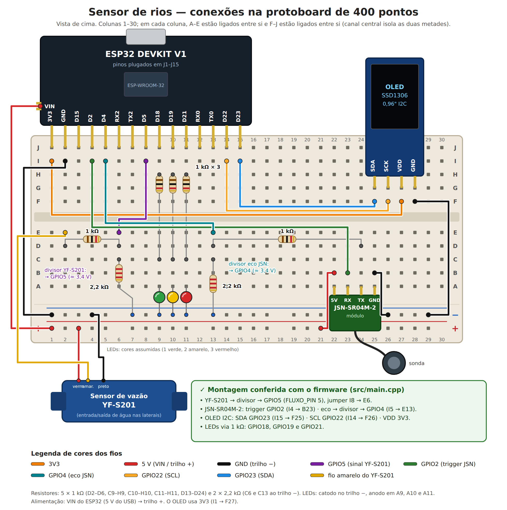

# Projeto físico — Sensor de rios

Firmware PlatformIO para ESP32 DevKit V1 (framework Arduino), versão atual do sensor físico.

## Funcionamento

* **Nível:** o JSN-SR04M-2 mede a distância até a água; a distância vira % entre `DISTANCIA_VAZIO_CM` (30 cm → 0 %) e `DISTANCIA_CHEIO_CM` (20 cm → 100 %).
* **Vazão:** o YF-S201 gera pulsos contados por interrupção (borda de subida); a cada 2 s o firmware calcula `(pulsos / 450) × 30` L/min.
* **Status e LEDs:** < 33 % verde (NORMAL), 33–66 % amarelo (ATENCAO), > 66 % vermelho (PERIGO).
* **Display:** OLED SSD1306 128×64 mostra nível, distância, vazão e status; o Serial (115200) repete as leituras.
* Leitura inválida do ultrassônico: mantém a última distância e o último nível válidos.

## Pinos do firmware

| Função | GPIO |
|---|:--:|
| OLED SDA / SCL | 23 / 22 |
| JSN-SR04M-2 trigger (`JSN_RX`) / eco (`JSN_TX`) | 2 / 4 |
| YF-S201 (`FLUXO_PIN`) | 5 |
| LED verde / amarelo / vermelho | 18 / 19 / 21 |

Esses pinos conferem com a montagem na protoboard (verificado por `diagrama/verificar_conexoes.py`).

## Montagem na protoboard

Diagrama completo das conexões (jumpers, resistores, LEDs, display e sensores): [`diagrama/conexoes-protoboard.md`](diagrama/conexoes-protoboard.md).



## Comandos

```bash
pio run                  # compilar
pio run -t upload        # gravar no ESP32
pio device monitor       # monitor serial (115200)
```

A pasta `.pio/` (build e bibliotecas baixadas) é ignorada pelo Git e recriada pelo PlatformIO.
A compilação também roda automaticamente no GitHub Actions (`.github/workflows/build.yml`).

Análise dos cálculos de nível e vazão: [`../modelo-calibracao/analise-calculos-sensores.md`](../modelo-calibracao/analise-calculos-sensores.md).
Lista de materiais: [`../hardware/lista-de-materiais.md`](../hardware/lista-de-materiais.md).
